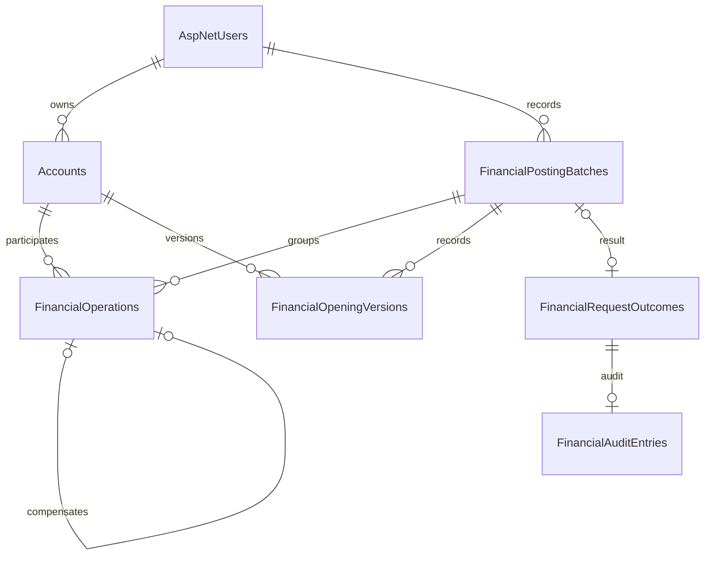

# Financial Journal Persistence

Status: journal storage implemented. The subsequent [opening](financial-opening-writer.md), [Income/Expense](financial-income-expense.md), [Transfer](financial-transfers.md) and [Reversal](financial-reversals.md) increments add controlled write/read cases; financial HTTP endpoints remain unimplemented.

The accepted policy is [ADR-002](decisions/ADR-002-financial-operation-journal.md). This increment implements relational storage for simulated financial history. The storage increment itself executes no financial commands. Subsequent increments implement controlled opening, Income/Expense/Transfer/Reversal and derived-balance reads, with atomic opening correction added subsequently and no financial HTTP endpoints. FinancialTransferWriter adds only procedure/grant changes; table mappings and the effects view remain unchanged. All seven migrations are validated only in the marked test database; development retains InitialPersistence.

## Review and mapping decision

The existing Domain types remain unchanged. EF cannot bind FinancialOperation's nested posting context/amount through its constructor as scalar properties. Reconstructing FinancialPostingContext through its current constructor would also recalculate a historical effective date using today's timezone rules.

Infrastructure therefore maps dedicated storage records in Persistence/FinancialJournal, rather than adding Domain setters, persistence constructors, mutable navigation properties, or framework dependencies. FinancialOperationRecord.FromDomain copies validated immutable facts; ReadAmount reconstructs FinancialAmount from the stored decimal/currency. Batch materialization restores the stored effective date and timezone directly. There is deliberately no speculative reverse mapper that rebuilds a FinancialOperation from current Account snapshots or silently recalculates its historical date.

This is a storage representation, not a second financial workflow or a generic repository. FinancialCommandType and FinancialOutcomeKind describe durable protocol metadata in Infrastructure.

## Relations and ownership

| Relation | Stored facts and keys |
| --- | --- |
| FinancialPostingBatches | Guid Id PK; UserId; command type; datetimeoffset(7) RecordedAtUtc; date EffectiveDate; varchar(64) accounting zone; unique identity bigint Sequence |
| FinancialOperations | Guid Id PK; owner/batch/kind/currency; nullable decimal(28,2) magnitude; participant IDs; nullable original ID/kind; optional nvarchar(200) reason |
| FinancialOpeningVersions | PK (UserId, Currency, AccountId, Revision); nullable PreviousRevision; batch; optional typed Opening reference; required reason |
| FinancialRequestOutcomes | Guid Id PK; owner/command/key; fingerprint/version; Posted or Rejected; optional batch; result code; bounded JSON receipt; UTC timestamp |
| FinancialAuditEntries | Guid Id PK; owner/outcome; UTC timestamp; action; bounded JSON summary; at most one entry per outcome |
| FinancialAccountMovements | Keyless read-only SQL view of signed ordinary and compensating account effects, with batch sequence and date metadata |

No separate Money, transaction-leg, cached-balance, or materialized-effects table is introduced. The view performs no aggregation or balance calculation. Transfer effects are derived from one canonical operation, and reversal effects are the exact sign inverse of its original.

Confirmed is the implicit journal-row state. There is no mutable status column or reversed flag, matching the current single-state Domain contract.

Existing Identity columns/tables and the initial migration are unchanged. Accounts receives only AK_Accounts_UserId_Currency_Id, needed for same-owner/currency composite foreign keys. It does not add ownership/name uniqueness or prevent multiple currencies per user. EF now rejects attempts to change the persisted owner/currency immediately because they participate in an alternate key; the previous regression assertion covers that earlier failure.

All new relationships use NO ACTION. Financial references prevent deleting their batch, account, owner or referenced original through a cascade.



The diagram is structural: SQL uniqueness ensures at most one compensation/audit/result link, not the complete future writer protocol.

## Exact monetary representation and text

FinancialAmount.MaximumValue is 99999999999999999999999999.99: 26 integer digits and two fractional digits, 28 total. SQL decimal(28,2) represents it exactly within CLR decimal. Round-trip tests use the maximum for all ordinary kinds and both supported currencies. Money itself retains its full signed/zero range and is not silently mapped to a narrower column.

The operation CHECK requires an ordinary magnitude greater than zero. Reversals have null magnitude and participants; they refer to an original instead. SQL type capacity supplies the upper bound.

SQL conversion to scale 2 can round before CHECK evaluation. A real test demonstrates that a raw INSERT of 1.001 can become 1.00. This is not a safe command boundary. DbContext validates added financial magnitudes through Money/FinancialAmount before binding parameters; the future writer must reject excess meaningful precision at its own input boundary too.

Idempotency keys are case-sensitive varchar(128), with a binary collation, 1-128 ASCII letters/digits/hyphen/underscore. Fingerprints are char(64) uppercase hexadecimal SHA-256 representations with a positive encoding version. Added outcomes validate key/fingerprint characters and lengths before varchar/char conversion can lose information. SQL CHECKs independently reject malformed stored representations. The subsequent opening procedure implements canonical fingerprint calculation/version comparison/replay; the storage records alone do not.

Receipts are Unicode JSON, at most 16,384 UTF-16 code units; audit summaries are Unicode JSON, at most 4,096. Codes/actions are bounded ASCII tokens. These fields must contain approved server-produced summaries, not credentials or unrestricted request bodies.

## Constraints and indexes

- Batch IDs/owners, operation IDs and batch references must be non-empty; ownership is also enforced through FKs.
- Command types are 1-6; operation kinds are 1-5 with explicit null/shape branches. CHECK UNKNOWN cannot bypass required nullable branches.
- Currency is exactly uppercase DOP/USD. Ordinary participant FKs include UserId and Currency; transfers require distinct participant IDs.
- Typed original references include owner, currency and original kind. Reversal shape permits original kinds 1-4 only; self-reference is forbidden.
- A filtered unique (UserId, OriginalOperationId) index permits at most one stored full reversal per original across commands/keys.
- Opening revision 1 has no predecessor; later revisions require revision minus one and its FK. The composite PK prevents duplicate roots/revisions.
- Positive opening revisions reference an Opening of the same owner, currency and batch. A zero revision has no operation/kind and creates no zero monetary row. A filtered unique opening reference prevents reuse across revisions.
- Outcomes are unique by (UserId, CommandType, IdempotencyKey). Posted results require a matching owner/command batch; Rejected results have no batch. A batch has at most one linked result.
- Audit references the same owner's outcome, with a unique owner/outcome index.
- Participant/batch/owner-date indexes support future reads without persisting balances. Sequence is a clustered unique identity; it can have gaps and is not a global commit watermark.

## Immutable history and explicit limits

All five tables have INSTEAD OF UPDATE, DELETE triggers raising SQL error 51001. DbContext separately rejects tracked modifications/deletions and configures after-save properties to throw. SQL OUTPUT is disabled for these mapped tables to support their triggers. Inserts remain possible for migration/test administrators; the original storage migration created no runtime role. InitialFinancialWriter now adds an EXECUTE-only opening/read role with explicit direct-history denials.

These safeguards are not tamper evidence against a sysadmin or a principal allowed to disable triggers/change schema. Least-privilege execution grants and the single permitted INSERT protocol belong to the future writer increment.

The schema alone does not prove the following. Initial opening now implements the applicable writer/read checks; other commands and production deployment remain deferred. See financial-opening-writer.md for exact evidence and residual limits:

| Pending guarantee | Required later boundary |
| --- | --- |
| Sufficient funds, headroom, initialization and current account status | Locked fresh reads and complete final-batch validation |
| Operation/batch command compatibility, exact correction contents and current opening selection | Controlled writer and revision checks |
| Opening revision's account equals its referenced operation's destination | Writer cross-row validation; current FKs enforce owner/currency/batch/kind |
| Reversal uses a distinct original batch and does not predate it | Writer cross-row checks; Domain factories validate supplied immutable originals |
| EffectiveDate matches the recording instant's accounting calendar, current clock/no user backdating | Trusted SQL UTC capture and approved timezone calculation |
| Every batch has its complete outcome/audit and every rejection has audit | One SQL transaction and reviewed INSERT protocol |
| Identical retry returns its original receipt; changed payload conflicts | Persistent fingerprint/version comparison and replay |
| Serialization, overdraft prevention, rollback under faults and commit ambiguity | Independent committed connections and future writer tests |

The effects view exposes structural rows; it must not be published as a balance/complete financial read until the writer guarantees complete batches. Tests inserting rows directly are schema probes, not financial-command implementations.

## Migration and review

New migration: 20261123215517_FinancialJournalPersistence.

Its Up operations create five tables/indexes, five append-only triggers and one view, plus the necessary Accounts alternate key. The reviewed [idempotent SQL artifact](../backend/scripts/sql/FinancialJournalPersistence.sql) contains no DROP TABLE, DROP COLUMN, changed existing columns, Identity DDL changes or existing application-data writes. __EFMigrationsHistory records the migration as normal.

CREATE VIEW/TRIGGER uses dynamic DDL inside its own batch so the generated idempotent IF guards remain valid. Custom SQL is frozen in FinancialJournalPersistence.Sql.cs; the EF snapshot also declares the view/trigger metadata. The migration is forward-only: Down throws rather than silently destroying confirmed history. Any correction/rollback needs a separately reviewed forward migration and recovery plan.

API startup still never runs Migrate/EnsureCreated. Update-Database.ps1 is now explicitly pinned to InitialPersistence, rather than implicitly applying the latest available migration after an initial-only preflight.

### Review and future development application

Run from the Vault-Finance directory:

```powershell
dotnet restore VaultFinance.slnx
dotnet build VaultFinance.slnx --no-restore
dotnet ef migrations has-pending-model-changes --project backend/src/VaultFinance.Infrastructure --startup-project backend/src/VaultFinance.Api --no-build -- --environment Development
dotnet ef migrations script 20261123172009_InitialPersistence 20261123215517_FinancialJournalPersistence --idempotent --project backend/src/VaultFinance.Infrastructure --startup-project backend/src/VaultFinance.Api --no-build --output backend/scripts/sql/FinancialJournalPersistence.sql -- --environment Development
```

Do not run the next command as part of tests. After independently verifying DefaultConnection targets VaultFinanceDb, reviewing existing data/schema/history, taking an appropriate backup and approving the additive SQL, the developer can explicitly apply:

```powershell
dotnet ef database update 20261123215517_FinancialJournalPersistence --project backend/src/VaultFinance.Infrastructure --startup-project backend/src/VaultFinance.Api --context VaultFinanceDbContext -- --environment Development
```

No development migration application is performed by this increment. Do not use a downgrade, migration removal on an applied environment, EnsureDeleted or a database reset as cleanup.

## Dedicated SQL test configuration and lifecycle

SQL tests no longer use DefaultConnection or VaultFinanceDb. Configure ConnectionStrings:SqlTestConnection through API User Secrets, or ConnectionStrings__SqlTestConnection in the process environment. It must target exactly VaultFinanceJournalTests on the allowlisted local SQLEXPRESS instance with Windows authentication. Preserve the approved encrypted transport settings. Do not commit its value or paste credentials into shared output.

Example configuration command, with a placeholder rather than an actual connection:

```powershell
dotnet user-secrets set "ConnectionStrings:SqlTestConnection" "<dedicated-test-connection>" --project backend/src/VaultFinance.Api
```

The fixture rejects system/development/remote databases, attached files and failover targets before opening a connection. It also preserves production DI's VaultFinanceDb-only guard: only test registrations substitute the dedicated context.

First explicit test provisioning and complete validation:

```powershell
$env:VAULTFINANCE_SQL_TESTS = '1'
$env:VAULTFINANCE_SQL_TESTS_CREATE_DATABASE = '1'
try {
    dotnet test VaultFinance.slnx --no-build --no-restore --logger "trx;LogFilePrefix=journal" --results-directory .local/test-results/sql-journal
} finally {
    $env:VAULTFINANCE_SQL_TESTS = $null
    $env:VAULTFINANCE_SQL_TESTS_CREATE_DATABASE = $null
}
```

For later runs, omit the creation flag or set it to 0. Run-SqlTests.ps1 offers the same opt-in flow with -CreateDatabase and -NoBuild switches, where local script execution is permitted. The direct commands above work without changing PowerShell execution policy.

Provisioning reads catalog existence in master, creates only the fixed dedicated database when explicitly allowed and absent, and immediately marks it with database-level extended property VaultFinance.TestDatabaseOwner = VaultFinance.JournalPersistenceTests.v1. An existing database without that marker, with foreign tables or unknown migration history is refused before migration. A partially created/unmarked database requires manual investigation; no automatic deletion/replacement is attempted.

Only a verified owned test database is migrated. No database is ever dropped/reset/cleared. Most tests use isolated synthetic transactions and rollback. History_RejectsSqlUpdatesDeletesAndCascadesAcrossIndependentConnections commits one synthetic owner/account/batch/operation/opening-version/outcome/audit group, then checks from another connection that all five tables reject changes/deletes and parent deletion fails. That immutable synthetic history is intentionally retained; repeated runs use new Guid owners and never delete earlier history. This is the safe cleanup strategy, not a shared development-data purge.

Authentication/account HTTP tests continue to use their existing per-test shared SQL transaction and rollback. They do not establish inter-request financial concurrency guarantees.

## Historical storage-increment results and previous count diagnosis

- Restore succeeded; build completed with zero warnings/errors.
- All 126 existing Domain unit cases passed unchanged.
- All 176 integration cases passed: 109 previous cases plus 24 new configuration/safety cases and 43 new real SQL cases.
- Total: 302 passed, 0 failed, 0 skipped in the SQL-enabled final run.
- Dedicated migration history contains InitialPersistence and FinancialJournalPersistence; EF reports no pending model changes or test-database migrations.
- A separate read-only review confirms VaultFinanceDb still has InitialPersistence only and none of the five financial tables.
- That storage-only increment implemented no financial command/endpoint/writer/balance. The subsequent opening increment retains all 302 cases and adds 24 Application unit plus 43 real SQL cases, totaling 369 passes; see the opening document.

The earlier 32 skips were opt-in facts/theories disabled by VAULTFINANCE_SQL_TESTS, not failed SQL tests. Disabled theories count as skipped methods; enabling them expands their inline cases, yielding 80 SQL cases plus 29 ordinary integrations = 109. The historical 181 was 72 unit + 109 integration. Domain increment 1 increased unit cases to 126 while SQL remained disabled. The current increment restores the SQL suite on a separate test database and adds 67 integration cases.

The restricted Windows environment initially prevented encrypted SQL connections for both sqlcmd and SqlClient. Running the same reviewed tests outside that sandbox succeeded without changing encryption/certificate settings. Script execution policy also blocked direct .ps1 invocation; equivalent dotnet commands were used without changing the machine policy. Two old immutability assertions initially failed because EF now rejects key mutation earlier; their assertion boundary was corrected and the final full run passed.

References: [EF constructor binding](https://learn.microsoft.com/en-us/ef/core/modeling/constructors), [SQL decimal conversion](https://learn.microsoft.com/en-us/sql/t-sql/data-types/decimal-and-numeric-transact-sql?view=sql-server-ver15), [SQL CHECK/UNIQUE constraints](https://learn.microsoft.com/en-us/sql/relational-databases/tables/unique-constraints-and-check-constraints?view=sql-server-ver15).
